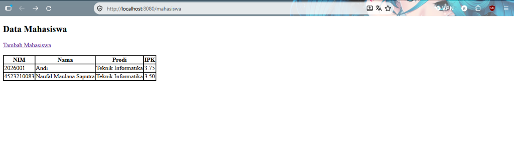

# Bagian Setup & Read (Anggota 1)

## 1. Deskripsi Tugas
Tugas 8 membangun modul manajemen data mahasiswa sederhana berbasis arsitektur MVC menggunakan **CodeIgniter 4**. Bagian **Setup & Read** mencakup instalasi project CI4, konfigurasi environment dan database MySQL, pembuatan `MahasiswaModel`, pengaturan routing, serta halaman daftar mahasiswa (`/mahasiswa`).

## 2. Versi Framework & PHP
- **PHP**: `8.3.33`
- **CodeIgniter 4**: `4.7.6` (`codeigniter4/appstarter`)
- **Composer**: `2.11.1`

## 3. Konfigurasi Database
Konfigurasi dilakukan dengan menyalin file `env` menjadi `.env` lalu mengaktifkan mode `development` dan pengaturan database MySQL:

```ini
CI_ENVIRONMENT = development

database.default.hostname = localhost
database.default.database = akademik_ci4
database.default.username = root
database.default.password =
database.default.DBDriver = MySQLi
database.default.port = 3306
```

Struktur database `akademik_ci4` dan tabel `mahasiswa` tersedia pada file `database.sql`:
- `id` (`INT`, `AUTO_INCREMENT`, `PRIMARY KEY`)
- `nim` (`VARCHAR(20)`, `NOT NULL`, `UNIQUE`)
- `nama` (`VARCHAR(100)`, `NOT NULL`)
- `prodi` (`VARCHAR(100)`, `NOT NULL`)
- `ipk` (`DECIMAL(3,2)`, `NOT NULL`)

## 4. Struktur Folder
```text
p8-akademik-ci4/
├── app/
│   ├── Config/
│   │   └── Routes.php
│   ├── Controllers/
│   │   └── MahasiswaController.php
│   ├── Models/
│   │   └── MahasiswaModel.php
│   └── Views/
│       └── mahasiswa/
│           └── index.php
├── public/       # Asset publik & entry point (index.php)
├── tests/        # File pengujian aplikasi
├── vendor/       # Library dependensi Composer
├── writable/     # File cache, logs, dan session yang ditulis aplikasi
└── builds        # File untuk build aplikasi
```

## 5. Routes
Konfigurasi pada `app/Config/Routes.php`:
```php
$routes->get('/', 'Home::index');
$routes->get('/mahasiswa', 'MahasiswaController::index');
```
Route `GET /mahasiswa` mengarahkan permintaan ke method `index()` pada `MahasiswaController`.

## 6. Penjelasan Model dan Halaman Daftar
- **Model (`app/Models/MahasiswaModel.php`)**:
  Menggunakan `CodeIgniter\Model` yang terhubung ke tabel `mahasiswa` dengan primary key `id` serta `$allowedFields = ['nim', 'nama', 'prodi', 'ipk']`.
- **Controller (`app/Controllers/MahasiswaController.php`)**:
  Method `index()` membuat instance `MahasiswaModel`, mengambil seluruh baris data menggunakan `$model->findAll()`, dan mengirimkannya ke view `mahasiswa/index`.
- **View (`app/Views/mahasiswa/index.php`)**:
  Menampilkan tabel HTML berisi kolom **NIM, Nama, Prodi, IPK** dengan perulangan `foreach ($mahasiswa as $mhs)` dan fungsi `esc()` untuk mencegah XSS, serta tautan `Tambah Mahasiswa` menuju `/mahasiswa/tambah`.

## 7. Screenshot Halaman Daftar (`/mahasiswa`)

